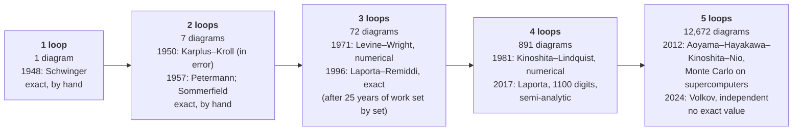

# The computation: the electron's anomalous magnetic moment

[README](../README.md) · [What does "proved" mean?](WHAT-IS-PROVED.md) ·
[Current status](campaign/STATUS.md)

This page explains which number this project is verifying, why computing it is hard, and how far the
formal verification has come. It is written for readers with a background in mathematics, physics or
engineering, but not necessarily in quantum field theory. Numerical values are rounded. The
references at the end give the published values and their uncertainties.

## 1. What is being computed

An electron has spin, and with it a magnetic moment: it behaves like a very small bar magnet. The
moment is proportional to the spin, with a constant of proportionality $g\,e/2m$, where $e$ and $m$
are the electron's charge and mass and $g$ is a pure number, the *g-factor*. Dirac's relativistic
equation for the electron [1] predicts $g=2$ exactly. In 1947–48 Kusch and Foley [2] measured a value
slightly larger than 2. The excess is the *anomalous magnetic moment*,

$$a_e=\frac{g-2}{2}\approx 0.001\,159\,652\,180\,59 .$$

In quantum electrodynamics (QED), the quantum theory of electrons and photons, $a_e$ comes from the
electron's interaction with virtual photons and virtual electron–positron pairs. It is computed as a
power series in the fine-structure constant $\alpha\approx1/137.036$, written in the variable
$\alpha/\pi\approx0.002\,32$:

$$a_e=\sum_{n\ge1}A_1^{(2n)}\left(\frac{\alpha}{\pi}\right)^{n}+a_e(\mu,\tau)+a_e(\text{hadronic})+a_e(\text{electroweak}).$$

- $A_1^{(2n)}$, the *n-loop coefficient*, is the sum of all Feynman diagrams with $n$ loops (order
  $e^{2n}$ in the charge). It is a pure number that QED determines completely, with no measured
  input [12].
- $a_e(\mu,\tau)$ collects diagrams containing a closed loop of a muon or a tau lepton, the electron's
  heavier copies. It depends on the mass ratios $m_e/m_\mu$ and $m_e/m_\tau$.
- The hadronic and electroweak terms come from quarks and from the W, Z and Higgs bosons. They lie
  outside QED proper and, for the electron, are tiny (section 5).

The measured value is known to 0.11 parts per billion (ppb) [19], and theory can be carried to the
same precision. The comparison tests the Standard Model at about one part in $10^{12}$ of $g$ [19],
which is why $a_e$ is often called the most precisely tested prediction in physics. It also works in
reverse: assuming the theory, the measurement of $a_e$ gives a value of $\alpha$ comparable in
precision to the best direct determinations [19].

## 2. A short history

**Theory.** Schwinger's 1948 calculation [3] of the one-loop diagram gave $a_e=\alpha/2\pi$, that is
$A_1^{(2)}=1/2$, in agreement with Kusch and Foley. It was one of the first successes of renormalized
QED. The two-loop coefficient (7 diagrams) was first computed by Karplus and Kroll in 1950 [4]; an
error in that work was found, and the correct value obtained, by Petermann [5] and independently by
Sommerfield [6] in 1957. Its closed form is

$$A_1^{(4)}=\frac{197}{144}+\frac{\pi^2}{12}-\frac{\pi^2}{2}\ln2+\frac34\zeta(3)=-0.328\,478\,965\,579\ldots$$

The three-loop coefficient (72 diagrams) was evaluated analytically set by set over more than two
decades, a program completed by Laporta and Remiddi in 1996 [7]:

$$A_1^{(6)}=\frac{83}{72}\pi^2\zeta(3)-\frac{215}{24}\zeta(5)+\frac{100}{3}\left[\mathrm{Li}_4\!\left(\tfrac12\right)+\frac{\ln^42}{24}-\frac{\pi^2\ln^22}{24}\right]-\frac{239}{2160}\pi^4+\frac{139}{18}\zeta(3)-\frac{298}{9}\pi^2\ln2+\frac{17101}{810}\pi^2+\frac{28259}{5184}=1.181\,241\,456\,587\ldots$$

The four-loop coefficient (891 diagrams) was computed numerically over many years by Kinoshita and
collaborators. In 2017 Laporta evaluated all 891 diagrams to 1100 digits [8], "finalizing a
twenty-year effort" in his words, and obtained $A_1^{(8)}=-1.912\,245\,764\,926\,445\,574\ldots$.
He fitted a semi-analytic expression to this value. It contains harmonic polylogarithms at roots of
unity, one-dimensional integrals of products of complete elliptic integrals, and six pieces still
known only numerically (to 4800 digits). His value agrees with the numerical result of Aoyama,
Hayakawa, Kinoshita and Nio, $-1.912\,98(84)$, within 0.9 standard deviations. The five-loop
coefficient is the subject of section 3.

**Experiment.** Modern measurements observe a single electron held in a Penning trap.

| Year | Measurement | Uncertainty of $a_e$ | Relative to $g/2$ | Relative to $a_e$ |
| --- | --- | ---: | ---: | ---: |
| 1987 | Van Dyck, Schwinberg, Dehmelt [16] | ≈ 4 × 10⁻¹² | ≈ 4 ppt | ≈ 4 ppb |
| 2006 | Odom, Hanneke, D'Urso, Gabrielse [17] | ≈ 0.76 × 10⁻¹² | ≈ 0.76 ppt | ≈ 0.65 ppb |
| 2008 | Hanneke, Fogwell, Gabrielse [18] | 0.28 × 10⁻¹² | 0.28 ppt | 0.24 ppb |
| 2023 | Fan, Myers, Sukra, Gabrielse [19] | 0.13 × 10⁻¹² | 0.13 ppt | 0.11 ppb |

The 2023 result is $g/2=1.001\,159\,652\,180\,59(13)$. The 1987 and 2006 uncertainties are inferred
from the 2008 paper, which reports an uncertainty 15 and 2.7 times smaller than theirs.

## 3. Five loops: two independent computations

The five-loop coefficient involves 12,672 diagrams. No analytic result exists; it has been computed
numerically by exactly two groups, each over many years and on supercomputers.

- **Aoyama, Hayakawa, Kinoshita and Nio**, a collaboration based largely at RIKEN in Japan,
  generate the integrand of each diagram automatically, as an integral over Feynman parameters from
  which the ultraviolet and infrared divergences have been subtracted, and integrate it by adaptive
  Monte Carlo. For example, the 6,354 diagrams without closed fermion loops are combined into 389
  integrals over 13 variables, and each integrand is about 100,000 lines of generated Fortran [12].
  Their first complete value was $A_1^{(10)}=9.16(58)$ in 2012 [9], revised to $7.795(336)$ in 2015
  [10] and to $6.737(159)$ in 2019 [12], after a further revision in 2018 [11].
- **Volkov** uses an independent method: a different subtraction procedure that removes all
  ultraviolet and infrared divergences before integration, and non-adaptive Monte Carlo integration
  with sampling densities built from each graph's structure [13].

The two disagreed. In 2019 Volkov obtained $6.793(90)$ for the diagrams without lepton loops, against
the then-current RIKEN value $7.668(159)$, a difference of 4.8 standard deviations [13]. In 2024 he
completed all five-loop diagrams and obtained $A_1^{(10)}=5.891(61)$, 5 standard deviations from the
RIKEN total [14]. In 2025 the RIKEN group compared the two calculations diagram by diagram, in 389
parts [15]. No single diagram differed significantly, but the differences for 98 diagrams with a
common structure were not randomly distributed, and together they produced the discrepancy.
Recomputing those 98 integrals with more statistics gave $6.800(128)$ for the diagrams without
fermion loops, which the authors report resolves the discrepancy. Substituting this into their 2019
total gives about $5.87$, consistent with Volkov's $5.891(61)$. This page uses $A_1^{(10)}\approx5.89$.

The shift of about 0.85 in $A_1^{(10)}$ changes $a_e$ by $6\times10^{-14}$, less than half the
experimental uncertainty. The episode shows both the value of independent computations and the
difficulty of attaching reliable error bars to high-dimensional Monte Carlo integrals.

## 4. Why each loop is harder

| Loops $n$ | 1 | 2 | 3 | 4 | 5 | 6 |
| --- | ---: | ---: | ---: | ---: | ---: | ---: |
| Vertex diagrams | 1 | 7 | 72 | 891 | 12,672 | 202,770 |
| Known value | $1/2$ | exact: $\pi^2\ln2$, $\zeta(3)$ | exact: $\mathrm{Li}_4(\frac12)$, $\zeta(5)$ | semi-analytic: elliptic integrals | numerical only | not computed |

The diagram counts are from [12]; they grow factorially with the loop order. The number of diagrams is
only part of the difficulty.

- **More integration variables.** An $n$-loop diagram is an integral over $n$ four-dimensional loop
  momenta. Even after the reduction to Feynman parameters used in numerical work, a five-loop
  integral without fermion loops has 13 dimensions.
- **Divergences.** Individual diagrams diverge at large loop momenta (ultraviolet) and, when a
  massless photon attaches to an electron line that is on its mass shell, at small momenta (infrared).
  Ultraviolet divergences are removed by renormalization: counterterms fix the electron's physical
  mass and charge. From two loops on, divergent subdiagrams can be nested inside one another or
  overlap, and each needs its own subtraction. Infrared divergences cancel only between different
  diagrams.
- **Subtraction terms.** Numerical methods subtract the divergent parts inside the integrand before
  integrating. The finite remainder is a small difference of large terms, which makes the integrals
  hard to evaluate accurately.
- **Special functions.** The exact values climb a ladder of transcendental constants: rational
  numbers at one loop; $\pi^2\ln 2$ and $\zeta(3)$ at two; values of polylogarithms such as
  $\mathrm{Li}_4(\frac12)$ and $\zeta(5)$ at three; integrals of elliptic functions at four. No exact
  result is known at five loops.

**Who did each order first, and how.** Each new order took longer than the one before. From three
loops on, the first values came from numerical integration on computers, and the exact values came
decades later.

| Loops | Diagrams | First complete value | Method | Exact or most precise value |
| ---: | ---: | --- | --- | --- |
| 1 | 1 | Schwinger, 1948 [3] | analytic, by hand | exact: $1/2$ (Schwinger, 1948) |
| 2 | 7 | Karplus and Kroll, 1950 [4], with an error; corrected by Petermann [5] and Sommerfield [6], 1957 | analytic, by hand | exact (Petermann; Sommerfield, 1957) |
| 3 | 72 | Levine and Wright, 1971 [23] | numerical integration on a computer | exact (Laporta and Remiddi, 1996 [7]), completing analytic work begun in the early 1970s |
| 4 | 891 | Kinoshita and Lindquist, 1981 [24], "very preliminary" | numerical (Monte Carlo); later on supercomputers | 1100 digits and a semi-analytic form, with six pieces known only numerically (Laporta, 2017 [8]) |
| 5 | 12,672 | Aoyama, Hayakawa, Kinoshita and Nio, 2012 [9] | Monte Carlo on supercomputers | numerical only; two independent computations agree since 2025 (section 3) |

The gaps tell the story. One loop took one paper. Two loops took seven years, because the first
calculation contained an error. At three loops the first numerical value came in 1971 and the exact
value 25 years later. At four loops the gap was 36 years: from the first preliminary value in 1981
to Laporta's 1100 digits in 2017. At five loops there is still no exact value.

## 5. What each loop buys

With the CODATA 2022 value $\alpha^{-1}=137.035\,999\,177$ [22], so $\alpha/\pi=0.002\,322\,819\,464$,
the terms of the series are as follows. The last column is the uncertainty in each coefficient at which
its contribution would be uncertain by the 2023 experimental uncertainty, $1.3\times10^{-13}$.

| Term | Coefficient | Contribution to $a_e$ | Coefficient accuracy matching experiment |
| --- | ---: | ---: | ---: |
| 1 loop | $1/2$ | 1.161 409 732 × 10⁻³ | exact |
| 2 loops | −0.328 478 966 | −1.772 305 × 10⁻⁶ | 2 × 10⁻⁸ |
| 3 loops | 1.181 241 457 | 1.480 420 × 10⁻⁸ | 1 × 10⁻⁵ |
| 4 loops | −1.912 245 765 | −5.566 80 × 10⁻¹¹ | 4 × 10⁻³ |
| 5 loops | ≈ 5.89 | ≈ 3.98 × 10⁻¹³ | ≈ 2 |
| muon loops (two-loop term) | 5.197 × 10⁻⁷ | 2.80 × 10⁻¹² | |
| tau loops (two-loop term) | 1.84 × 10⁻⁹ | 9.9 × 10⁻¹⁵ | |
| all muon and tau terms | | 2.75 × 10⁻¹² | |
| hadronic | | 1.69 × 10⁻¹² | |
| electroweak | | 3.05 × 10⁻¹⁴ | |
| **measured $a_e$** (2023) | | 1.159 652 180 59(13) × 10⁻³ | |

The mass-dependent, hadronic and electroweak values are from [12]. Truncating the series shows what
each loop adds. Here "through $n$ loops" means all QED terms up to $(\alpha/\pi)^n$, including the muon
and tau terms of those orders; the error is the size of everything omitted, relative to $a_e$.

| Prediction through | Relative error | Correct digits of $a_e$ | Correct digits of $g/2$ |
| --- | ---: | ---: | ---: |
| 1 loop | 1.5 × 10⁻³ | ≈ 3 | ≈ 6 |
| 2 loops | 1.3 × 10⁻⁵ | ≈ 5 | ≈ 8 |
| 3 loops | 4.6 × 10⁻⁸ | ≈ 7 | ≈ 10 |
| 4 loops | 1.8 × 10⁻⁹ | ≈ 9 | ≈ 12 |
| 5 loops, with hadronic and electroweak terms | ≈ 1 × 10⁻¹¹ (theory, excluding $\alpha$) | ≈ 10 (experiment) | ≈ 13 (experiment) |

The number of correct digits is about $-\log_{10}$ of the relative error. Because $a_e$ is about
$10^{-3}$ of $g/2=1.001\,159\ldots$, each digit count for $g/2$ is about three more than for $a_e$. At
three loops the error is dominated by the four-loop term; at four loops, by the hadronic and five-loop
terms. For predicting $a_e$ alone, $A_1^{(6)}$ to about $\pm10^{-3}$ would already be enough at
three loops: it moves $a_e$ by at most $1.3\times10^{-11}$, under a quarter of the four-loop term.
This project aims higher than that (see section 6).

With all five loops and the non-QED terms, the theory's own uncertainty, from the five-loop and
hadronic terms, is about $10^{-14}$ in $a_e$ [12, 14], below the experimental $1.3\times10^{-13}$.
The limiting input is then $\alpha$ itself, since $a_e$ is very nearly proportional to it. The two
most precise determinations of $\alpha$ come from measuring the recoil of atoms absorbing photons:
caesium at Berkeley in 2018, $\alpha^{-1}=137.035\,999\,046(27)$ [20], and rubidium at the
Laboratoire Kastler Brossel in Paris in 2020, $\alpha^{-1}=137.035\,999\,206(11)$ [21]. They
differ by more than five standard deviations [21], and the predictions of $a_e$ they give differ by
about $1.4\times10^{-12}$, ten times the experimental uncertainty.

## 6. What this project does differently

The published coefficients come from analytic calculations supported by computer algebra, or from
numerical integration. This project instead builds a **machine-checked derivation** in the proof
assistant [Lean 4](https://lean-lang.org/) with its mathematics library, Mathlib. It starts from an
explicit definition of the regularized perturbative amplitudes:

- the expansion of the interaction into free-field contractions (Wick's theorem), with its
  combinatorics and fermion signs;
- regulators that make every integral finite: a heavy auxiliary photon of mass $\Lambda$
  (Pauli–Villars), a small photon mass, and auxiliary heavy fermions for closed fermion loops;
- loop integrals defined by an explicit limit (the energy integral first, then $i\varepsilon\to0^+$),
  in place of the formal Wick rotation of textbooks;
- counterterms fixed by the physical (on-shell) mass and charge conditions.

A coefficient is then a theorem: the magnetic form factor of this regulated amplitude tends to the
stated number as the regulators are removed in a stated order. Lean's kernel checks every step,
including every limit, integrability condition and exchange of integrals, using only the standard
axioms. Coefficients are proved as exact closed forms. Separately, numerical claims about them are
rigorous enclosures computed with interval arithmetic and checked by the kernel, not floating-point
estimates. [What does "proved" mean?](WHAT-IS-PROVED.md) explains the scope of such a claim.

**Done.**

- **One loop.** The proof runs from the model, through its own definition of the electron's current
  matrix element and two definitions of the magnetic moment (proved equivalent), to
  $F_2\to\alpha/2\pi$ and $g\to2(1+\alpha/2\pi)$, where $F_2$ is the magnetic form factor. A
  kernel-checked enclosure for the CODATA 2022 value of $\alpha$ places $\alpha/2\pi$ in the interval

  $$0.001\,161\,409\,731\,9 < \frac{\alpha}{2\pi} < 0.001\,161\,409\,732\,3 .$$

- **Two loops.** The complete mass-independent coefficient, exactly: the magnetic form factor of the
  two-loop electron–photon vertex tends to the closed form
  $\frac{197}{144}+\frac{\pi^2}{12}-\frac{\pi^2}{2}\ln2+\frac34\zeta(3)$ of section 2. The theorem's
  limit is this exact expression, not a decimal approximation, so the derivation reproduces the
  Petermann–Sommerfield result itself. A separate, much smaller theorem evaluates the expression
  numerically, to sixteen significant digits, confirming that it is the published number
  $-0.328\,478\,965\,579\,193\,78\ldots$:

  $$-0.328\,478\,965\,579\,193\,80 < A_1^{(4)} < -0.328\,478\,965\,579\,193\,76 .$$

  These bounds come from kernel-checked interval arithmetic on $\pi$, $\ln2$ and $\zeta(3)$, and
  can be tightened further. The mass-dependent two-loop terms from a muon or tau loop are also
  proved, as exact functions of the mass ratio, with certified enclosures at the measured ratios.
  The two-loop theorems concern the one-particle-irreducible vertex, which is all the coefficient
  needs; extending the full chain to the measured magnetic moment at two loops, as was done at one
  loop, is future work.

The one- and two-loop main theorems have also been re-checked by two independent proof checkers in
addition to Lean's own kernel. The two-loop result alone took about 320 Lean files and 100,000 lines.
Formalizing the calculation also found five misprints in the primary textbook source
([errata](ERRATA-AND-DEVIATIONS.md)).

**In progress: three loops.** The 72 diagrams fall into five gauge-invariant sets. The first is
done: two one-loop vacuum-polarization bubbles in a chain on the photon line of the one-loop diagram
(with its counterterm partners). Its contribution to $A_1^{(6)}$ is proved, exactly, to be
$\frac83\zeta(3)-\frac{4}{135}\pi^2-\frac{943}{324}\approx0.002\,558\,52$. On its own this set does
not improve the prediction; the complete $A_1^{(6)}$ does.

The accuracy target for three loops is the exact value. Laporta and Remiddi's 1996 result [7] is a
closed form in $\zeta(3)$, $\zeta(5)$, $\pi^2\ln2$, $\pi^4$, $\ln^42$ and
$\mathrm{Li}_4(\frac12)$, and the aim is to derive that closed form from the model, set by set, as was
done at two loops, so that their result is reproduced and independently verified rather than merely
approximated. The target is already fixed in Lean: Laporta and Remiddi's closed form is a definition,
with a kernel-checked evaluation to sixteen significant digits,

$$1.181\,241\,456\,587\,199\,5 < A_1^{(6)}\big|_{\text{Laporta–Remiddi}} < 1.181\,241\,456\,587\,200\,3 .$$

What remains is the theorem that the model's three-loop coefficient equals this closed form. The next
sets are the vacuum-polarization insertions (3 and 12 diagrams). The
light-by-light diagrams (6) and the 50 diagrams without fermion loops are much harder; the plan is to
reduce them analytically as far as possible, following the route of the original analytic
computations. If some piece has to be evaluated numerically for a time, its certified enclosure and
its width will be stated explicitly ([higher-loop plan](HIGHER-LOOP-PLAN.md)).

**Long-range goal.** Four and five loops, the mass-dependent terms of those orders, and the hadronic
and electroweak contributions and $\alpha$ as clearly labelled external inputs, assembled into a
prediction of $a_e$ with an explicit uncertainty budget to compare with experiment. This needs a
general formal treatment of nested and overlapping divergences and certified numerical integration in
many dimensions, both substantial research problems for formal mathematics.

**Not done.** None of the three-, four- or five-loop coefficients has yet been formally verified.

## 7. References

1. P. A. M. Dirac, "The quantum theory of the electron", *Proc. R. Soc. Lond. A* **117**, 610–624
   (1928). [doi:10.1098/rspa.1928.0023](https://doi.org/10.1098/rspa.1928.0023)
2. P. Kusch and H. M. Foley, "The magnetic moment of the electron", *Phys. Rev.* **74**, 250–263
   (1948). [doi:10.1103/PhysRev.74.250](https://doi.org/10.1103/PhysRev.74.250)
3. J. Schwinger, "On quantum-electrodynamics and the magnetic moment of the electron", *Phys. Rev.*
   **73**, 416–417 (1948). [doi:10.1103/PhysRev.73.416](https://doi.org/10.1103/PhysRev.73.416)
4. R. Karplus and N. M. Kroll, "Fourth-order corrections in quantum electrodynamics and the magnetic
   moment of the electron", *Phys. Rev.* **77**, 536–549 (1950).
   [doi:10.1103/PhysRev.77.536](https://doi.org/10.1103/PhysRev.77.536)
5. A. Petermann, "Fourth order magnetic moment of the electron", *Helv. Phys. Acta* **30**, 407 (1957);
   also *Nucl. Phys.* **5**, 677–683 (1958).
   [doi:10.1016/0029-5582(58)90065-8](https://doi.org/10.1016/0029-5582(58)90065-8)
6. C. M. Sommerfield, "Magnetic dipole moment of the electron", *Phys. Rev.* **107**, 328–329 (1957),
   [doi:10.1103/PhysRev.107.328](https://doi.org/10.1103/PhysRev.107.328); "The magnetic moment of
   the electron", *Ann. Phys.* **5**, 26–57 (1958).
   [doi:10.1016/0003-4916(58)90003-4](https://doi.org/10.1016/0003-4916(58)90003-4)
7. S. Laporta and E. Remiddi, "The analytical value of the electron (g−2) at order α³ in QED",
   *Phys. Lett. B* **379**, 283–291 (1996). [arXiv:hep-ph/9602417](https://arxiv.org/abs/hep-ph/9602417)
8. S. Laporta, "High-precision calculation of the 4-loop contribution to the electron g-2 in QED",
   *Phys. Lett. B* **772**, 232–238 (2017). [arXiv:1704.06996](https://arxiv.org/abs/1704.06996)
9. T. Aoyama, M. Hayakawa, T. Kinoshita and M. Nio, "Tenth-order QED contribution to the electron g−2
   and an improved value of the fine structure constant", *Phys. Rev. Lett.* **109**, 111807 (2012).
   [arXiv:1205.5368](https://arxiv.org/abs/1205.5368)
10. T. Aoyama, M. Hayakawa, T. Kinoshita and M. Nio, "Tenth-order electron anomalous magnetic moment:
    Contribution of diagrams without closed lepton loops", *Phys. Rev. D* **91**, 033006 (2015).
    [arXiv:1412.8284](https://arxiv.org/abs/1412.8284)
11. T. Aoyama, T. Kinoshita and M. Nio, "Revised and improved value of the QED tenth-order electron
    anomalous magnetic moment", *Phys. Rev. D* **97**, 036001 (2018).
    [arXiv:1712.06060](https://arxiv.org/abs/1712.06060)
12. T. Aoyama, T. Kinoshita and M. Nio, "Theory of the anomalous magnetic moment of the electron",
    *Atoms* **7**, 28 (2019). [doi:10.3390/atoms7010028](https://doi.org/10.3390/atoms7010028)
13. S. Volkov, "Calculating the five-loop QED contribution to the electron anomalous magnetic moment:
    Graphs without lepton loops", *Phys. Rev. D* **100**, 096004 (2019).
    [arXiv:1909.08015](https://arxiv.org/abs/1909.08015)
14. S. Volkov, "Calculation of the total 10th order QED contribution to the electron magnetic moment",
    *Phys. Rev. D* **110**, 036001 (2024). [arXiv:2404.00649](https://arxiv.org/abs/2404.00649)
15. T. Aoyama, M. Hayakawa, A. Hirayama and M. Nio, "Verification of the tenth-order QED contribution
    to the anomalous magnetic moment of the electron from diagrams without fermion loops",
    *Phys. Rev. D* **111**, L031902 (2025). [arXiv:2412.06473](https://arxiv.org/abs/2412.06473)
16. R. S. Van Dyck Jr., P. B. Schwinberg and H. G. Dehmelt, "New high-precision comparison of electron
    and positron g factors", *Phys. Rev. Lett.* **59**, 26–29 (1987).
    [doi:10.1103/PhysRevLett.59.26](https://doi.org/10.1103/PhysRevLett.59.26)
17. B. Odom, D. Hanneke, B. D'Urso and G. Gabrielse, "New measurement of the electron magnetic moment
    using a one-electron quantum cyclotron", *Phys. Rev. Lett.* **97**, 030801 (2006).
    [doi:10.1103/PhysRevLett.97.030801](https://doi.org/10.1103/PhysRevLett.97.030801)
18. D. Hanneke, S. Fogwell and G. Gabrielse, "New measurement of the electron magnetic moment and the
    fine structure constant", *Phys. Rev. Lett.* **100**, 120801 (2008).
    [arXiv:0801.1134](https://arxiv.org/abs/0801.1134)
19. X. Fan, T. G. Myers, B. A. D. Sukra and G. Gabrielse, "Measurement of the electron magnetic
    moment", *Phys. Rev. Lett.* **130**, 071801 (2023). [arXiv:2209.13084](https://arxiv.org/abs/2209.13084)
20. R. H. Parker, C. Yu, W. Zhong, B. Estey and H. Müller, "Measurement of the fine-structure constant
    as a test of the Standard Model", *Science* **360**, 191–195 (2018).
    [arXiv:1812.04130](https://arxiv.org/abs/1812.04130)
21. L. Morel, Z. Yao, P. Cladé and S. Guellati-Khélifa, "Determination of the fine-structure constant
    with an accuracy of 81 parts per trillion", *Nature* **588**, 61–65 (2020).
    [doi:10.1038/s41586-020-2964-7](https://doi.org/10.1038/s41586-020-2964-7)
22. NIST, "CODATA 2022 recommended value: inverse fine-structure constant", 137.035 999 177(21).
    [physics.nist.gov](https://physics.nist.gov/cgi-bin/cuu/Value?alphinv)
23. M. J. Levine and J. Wright, "Sixth-order magnetic moment of the electron", *Phys. Rev. Lett.*
    **26**, 1351–1353 (1971). [doi:10.1103/PhysRevLett.26.1351](https://doi.org/10.1103/PhysRevLett.26.1351)
24. T. Kinoshita and W. B. Lindquist, "Eighth-order anomalous magnetic moment of the electron",
    *Phys. Rev. Lett.* **47**, 1573–1576 (1981).
    [doi:10.1103/PhysRevLett.47.1573](https://doi.org/10.1103/PhysRevLett.47.1573)
